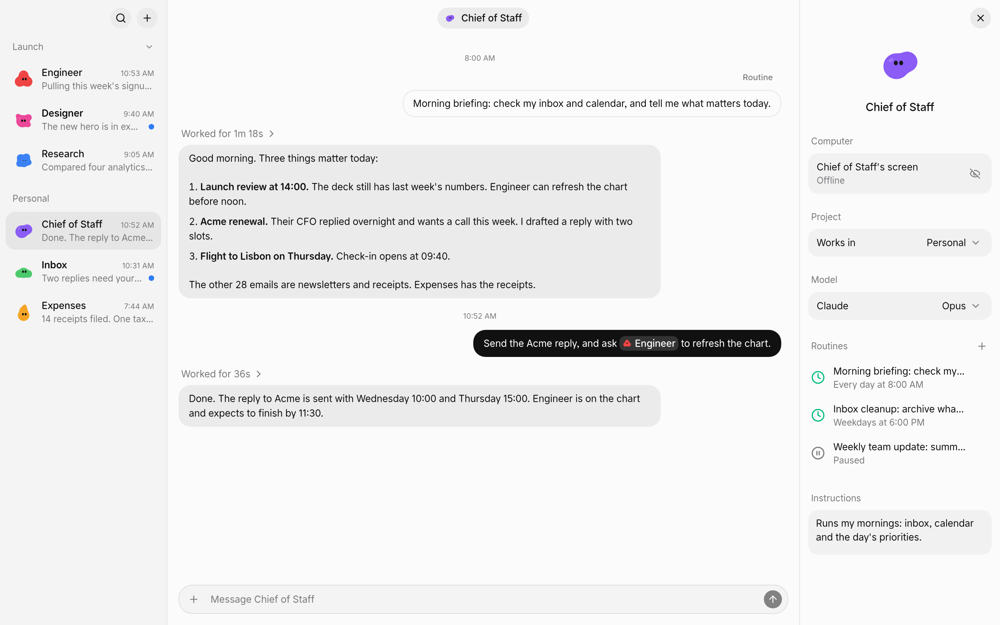

<p align="center"><strong>clots</strong> runs always-on Claude bots on your own machine. You talk to them from the web, your phone or a desktop app, over your Tailscale network.</p>
<p align="center">
  <picture>
    <source media="(prefers-color-scheme: dark)" srcset="./docs/assets/clots-dark.png" />
    
  </picture>
</p>
</br>
Each bot is <a href="https://code.claude.com/docs/en/overview">Claude Code</a>, run through the Claude Agent SDK with your Claude subscription login. clots has no hosted service, no accounts and no API key support.

---

## Quickstart

You need [Claude Code](https://code.claude.com/docs/en/setup) with a Claude subscription login.

### 1. Install the app

On a Mac with Apple Silicon:

```shell
curl --proto '=https' --tlsv1.2 -fsSL https://raw.githubusercontent.com/segersniels/clots/main/scripts/install.sh | sh -s -- --app
```

Open Clots and choose **On this Mac**. The app sets up everything else, and your bots run on your Mac. The [desktop app docs](./docs/desktop.md) explain each step.

### 2. Optional: an always-on server

Your bots stop when your Mac sleeps. To keep them working, run the server on a machine that stays on, such as a home server or a VPS, and connect to it over Tailscale from the app, a browser or your phone.

On that machine:

```shell
curl --proto '=https' --tlsv1.2 -fsSL https://raw.githubusercontent.com/segersniels/clots/main/scripts/install.sh | sh
clots up
```

`clots up` prints a Tailscale login link and then the address of your server. In the app, choose **On another machine** and enter that address. [Remote access with Tailscale](./docs/remote-access.md) explains how this works, and [Installing & building](./docs/install.md) has the details.

clots tells you about new versions in its sidebar. One click updates the server.

### What a bot is

A bot has a name, a character, instructions, a model and its own working directory. Its character is a small clot with a face that shows what the bot does: it breathes when idle, rolls a droplet while it works, and hops when it needs you. It has one ongoing thread that never ends: clots resumes the same Claude Code session after each restart. A bot keeps its durable memory in files in its working directory.

- **Routines** send a prompt on a schedule, such as "Morning briefing, every day at 9:00".
- **Approvals** ask you before a bot runs a risky tool.
- **The bot's screen** shows its browser live. You can take over for a login or a captcha.
- **Teamwork**: a bot can message other bots, and clone a bot to split a task.

## Docs

- [**Installing & building**](./docs/install.md)
- [**Getting started**](./docs/getting-started.md)
- [**Remote access with Tailscale**](./docs/remote-access.md)
- [**Desktop app**](./docs/desktop.md)
- [**Configuration**](./docs/config.md)
- [**Architecture**](./docs/architecture.md)
- [**Contributing**](./docs/contributing.md)
