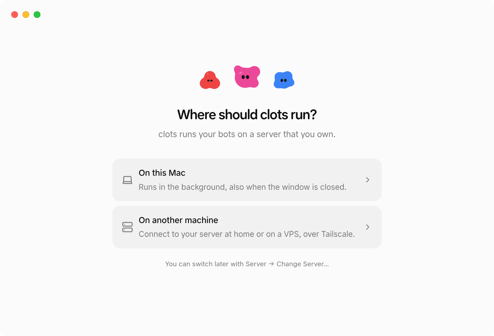
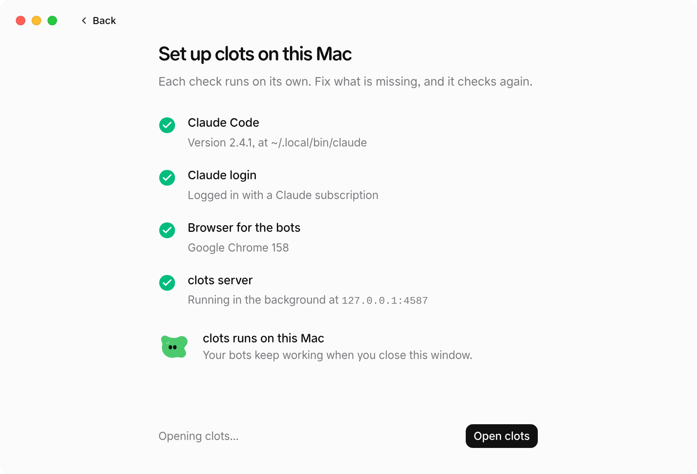

# Desktop app

The desktop app (`apps/desktop`) is an Electron window around the web client. It holds no copy of the client: it shows the client that your clots server serves. A server update therefore also updates the app.

> [!NOTE]
> The app is for Apple Silicon Macs. Releases are signed with a Developer ID and notarized by Apple.

## Install

```shell
curl --proto '=https' --tlsv1.2 -fsSL https://raw.githubusercontent.com/segersniels/clots/main/scripts/install.sh | sh -s -- --app
```

The script copies Clots from the latest release's disk image to Applications. A file that `curl` downloads has no quarantine flag, so macOS opens the app without a warning.

To install by hand, download [Clots.dmg](https://github.com/segersniels/clots/releases/latest/download/Clots.dmg) and drag Clots to Applications.

## First start

The app asks where clots runs:

<picture>
  <source media="(prefers-color-scheme: dark)" srcset="./assets/setup-choose-dark.png" />
  
</picture>

- **On this Mac:** the app checks that Claude Code is installed and logged in with a subscription. Then it installs the `clots` command that ships inside the app, downloads a browser for the bots when the Mac has no Chrome, and starts it as a background service with `clots up --local`. The server keeps running when you close the app, and it needs no Tailscale.

<picture>
  <source media="(prefers-color-scheme: dark)" srcset="./assets/setup-local-dark.png" />
  
</picture>

- **On another machine:** enter the address that `clots up` printed on that machine, for example `clots.your-tailnet.ts.net`. [Installing & building](./install.md) explains how to set up that server.

To change this later, use the menu **Server → Change Server…**.

## Updates

The sidebar shows new versions:

- **The server** updates itself when you click **Update**. This works for a server on this Mac and for one on another machine.
- **The app** checks GitHub for a new release when it starts and every hour, and shows **Clots app** with the new version. Click **Update** to download it in the background, then **Restart** to open the new version. An update that you do not install with **Restart** installs when you quit the app. With **On this Mac**, the new app also brings the new server: it installs it on the next start.

An app with an ad-hoc signature, such as one that you build yourself or one from before the first signed release, cannot update itself, because macOS replaces only an app with a Developer ID signature. Its **Clots app** row opens the release page instead. Run the install command again, or download the new DMG and replace the app in Applications.

## Run from source

```shell
bun run build:cli                     # the app installs this build for "On this Mac"
bun run --cwd apps/desktop start
```

## Build for macOS

On a Mac:

```shell
bun run --cwd apps/desktop package:mac
```

This builds the `clots` command, the app and `apps/desktop/release/Clots.dmg` for your Mac's processor, and opens the DMG. Drag Clots to Applications.

The build has an ad-hoc signature and no notarization, so it needs no Apple account. A DMG that you build on your own Mac opens without a warning, because macOS only checks apps that come from the internet.

## What the app does

- It stores your choice and the server address in the app's user data directory (`config.json`).
- It shows only the clots server and its own setup page. Other links open in your default browser.
- Only its setup page can ask it to run programs on your Mac. The web client of a server gets no access.
- It adds `clots-desktop/<platform>` to the user agent, so the web client can make room for the window buttons on macOS.
