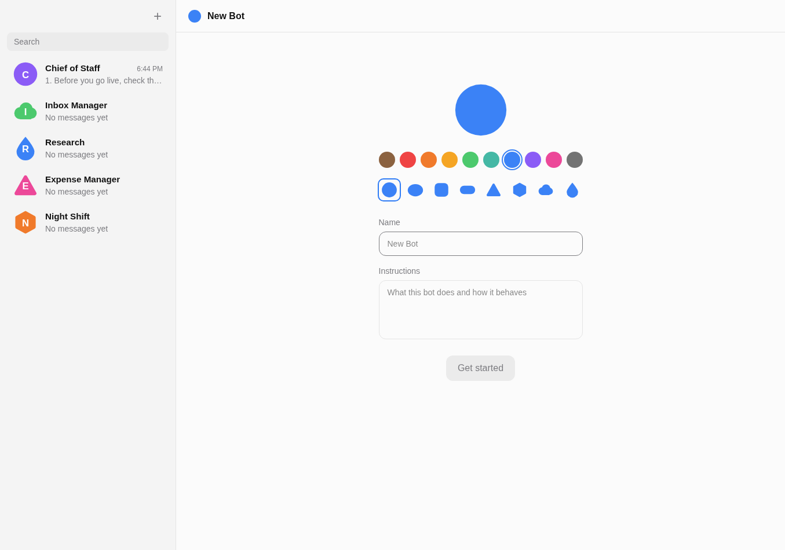

# Getting started

Open the web client: `http://127.0.0.1:4587` on the host, or your tailnet address from another device.

## Create a bot

1. Click **+** in the sidebar.
2. Pick a color and a shape for the picture.
3. Enter a name and the instructions. The instructions say what the bot does and how it behaves. clots adds them to the system prompt of Claude Code.
4. Click **Get started**.

Each bot gets its own working directory under `~/.clots/bots/`. The bot keeps its notes there, for example in `CLAUDE.md`. That is its durable memory.

## Chat

A bot has one ongoing thread. Write a message and press Enter. Shift+Enter adds a line.

- The reply streams in while the bot writes it.
- The square button stops the current turn.
- After a server restart, the history is there and the bot continues the same session.

## Approvals

A bot can edit files in its own working directory without a question. For other risky tools, such as a shell command, it asks you first. The request shows in the thread:

- **Allow once** runs this one call.
- **Always allow** also saves a permission rule, so the bot does not ask again for the same kind of call.
- **Skip** denies the call. The bot continues without it.

A bot that waits for you shows "Needs you" and a blue dot in the sidebar.

## The bot's screen

The details pane on the right shows the bot's browser live, when the bot has one open. Use the monitor icon in the chat header to open or close the pane.

- Click the screen to **take over**. Your mouse and keyboard then go to the page.
- Click **Give back** to return control.
- When a page needs you (a login, a captcha, a payment), the bot asks for a handoff in the thread. Take over, do the step, and click **I am done**.

Each bot has its own browser profile, so its logins stay.

## Model

The details pane has four model buttons: **Haiku**, **Sonnet**, **Opus** and **Fable**. A click changes the model at once, also in the middle of a thread. clots stores only the class. Claude Code picks the newest model of that class that your account can use.

A new bot starts on Opus.

## Routines

A routine sends a prompt to the bot on a schedule.

1. Click **+** next to **Routines** in the details pane.
2. Enter the prompt, for example "Morning briefing".
3. Pick a schedule, or pick **Custom cron** and enter a cron expression with five fields.
4. Click **Add routine**.

The clock icon pauses and resumes a routine. Schedules use the time zone of the host. A routine that was due while the server was down runs once after the start.
