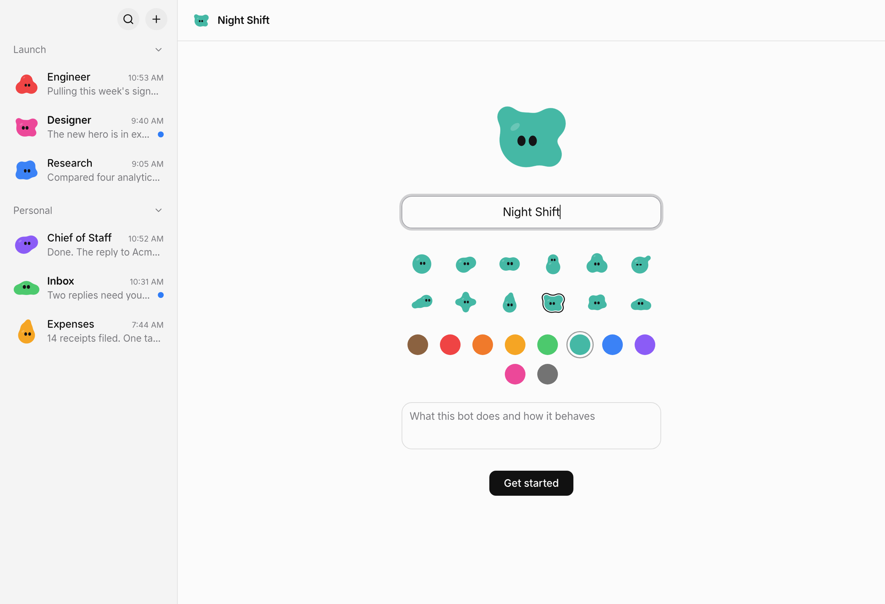
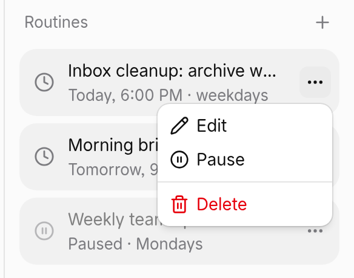

# Getting started

Open the Clots app, or the web client: `http://127.0.0.1:4587` on the host, or your tailnet address from another device.

## Create a bot

<picture>
  <source media="(prefers-color-scheme: dark)" srcset="./assets/new-bot-dark.png" />
  
</picture>

1. Click **+** in the sidebar, then **New bot**.
2. Enter a name.
3. Pick a shape and a color for the bot's character.
4. Enter the instructions. The instructions say what the bot does and how it behaves. clots adds them to the system prompt of Claude Code.
5. Click **Get started**.

Each bot gets its own working directory under `~/.clots/bots/`. The bot keeps its notes there, for example in `CLAUDE.md`. That is its durable memory.

## Projects

A project groups bots, and it can point at a folder on the server, for example a repository.

1. Click **+** in the sidebar and choose **New project**.
2. Enter a name. Optionally enter the directory, for example `~/code/mejl`.
3. Open a bot's details (click its name at the top of the chat) and pick the project under **Project**.

A bot of a project with a directory works in that directory. It then also gets the `CLAUDE.md`, the skills and the settings of that folder. Its own notes stay in its notes directory under `~/.clots/bots/`.

When you move a bot to another project, it starts a new Claude Code session, because a session belongs to one directory. The chat history stays, but the bot does not remember it.

The sidebar shows each project as a section that you can collapse. Bots without a project are under **Personal**.

## Chat

A bot has one ongoing thread. Write a message and press Enter. Shift+Enter adds a line.

- The reply shows when the bot finishes it.
- While a bot works, a closed line in the thread shows its current tool call. Click it to see all steps. When the bot finishes, the steps stay in the thread as a closed "Worked for …" line.
- The square button stops the current turn.
- After a server restart, the history is there and the bot continues the same session.
- Type `/` or `$` to pick one of the bot's skills, and `@` to mention another bot. The pick shows as a chip in the field.

When you start the app, it opens the bot that was open last.

## Bots that work together

Each bot can list the other bots, read their threads and send them a message. Mention a bot with `@` to tell your bot which one you mean. A message from a bot starts a turn of the other bot, and the answer stays in that bot's own thread.

A bot can also clone a bot and give the clone a task, for example one clone per pull request. The clone works in its own thread and reports back to the bot that made it.

- The sidebar shows clones under the bot that made them.
- A bot can have 10 clones at most. A clone cannot make clones.
- The bot that made a clone can delete it. A clone deletes itself only when you ask it to in your own message.

## The sidebar menu

Right-click a bot in the sidebar to:

- **Mark as unread** or **Mark as read**. An unread bot shows a dot.
- **Move to** another project, or to **Personal**.
- **Rename** the bot.
- **Clone** the bot. The copy gets the same instructions, character, model and project, and an empty thread.
- **Delete** the bot, with its thread, notes and browser profile.

## Files and images

Paste a file or an image into the message field, drop it there, or click **+** next to the field. The files show above the field until you send. A message can be files only.

- The bot sees an image at once (PNG, JPEG, GIF, WebP).
- For each file, the bot also gets the path of the stored copy, so it can read or use the file.
- The server keeps the files in the bot's notes directory, under `attachments/`. A file can be 10 MB at most.

## Approvals

A bot runs in the auto permission mode of Claude Code: a classifier allows safe tool calls and denies dangerous ones. When the classifier cannot decide, the bot asks you. The request shows in the thread:

- **Allow once** runs this one call.
- **Always allow** also saves a permission rule, so the bot does not ask again for the same kind of call.
- **Skip** denies the call. The bot continues without it.

A bot that waits for you shows "Needs you" and a blue dot in the sidebar.

## The bot's screen

The details pane on the right shows the bot's browser live, when the bot has one open. Use the monitor icon in the chat header to open or close the pane.

- Click the screen to **take over**. The bot's browser opens in a window, and your mouse and keyboard go to the page. The paste shortcut types your own clipboard into the page.
- The window has the bot's tabs, with **+** to open a tab and **×** to close one. The address bar opens what you type, and the buttons next to it go back, go forward, stop or reload the page. You can also copy the link, or open the page in your own browser.
- Click **Give back** to return control.
- Click **Stop** on the card to close the bot's browser.
- When a page needs you (a login, a captcha, a payment), the bot asks for a handoff in the thread. Take over, do the step, and click **I am done**.

Each bot has its own browser profile, so its logins stay.

## Model

The details pane has a model menu with four choices: **Haiku**, **Sonnet**, **Opus** and **Fable**. A choice changes the model at once, also in the middle of a thread. clots stores only the class. Claude Code picks the newest model of that class that your account can use.

A new bot starts on Opus.

## Routines

A routine sends a prompt to the bot on a schedule.

<picture>
  <source media="(prefers-color-scheme: dark)" srcset="./assets/routines-dark.png" />
  
</picture>

1. Click **+** next to **Routines** in the details pane.
2. Enter the prompt, for example "Morning briefing". Type `/` to pick a skill, or `@` to mention another bot.
3. Pick a schedule, or pick **Custom cron** and enter a cron expression with five fields.
4. Click **Add routine**.

Each routine shows when it runs next. Its **…** menu edits, pauses, resumes or deletes it. Schedules use the time zone of the host. A routine that was due while the server was down runs once after the start.
