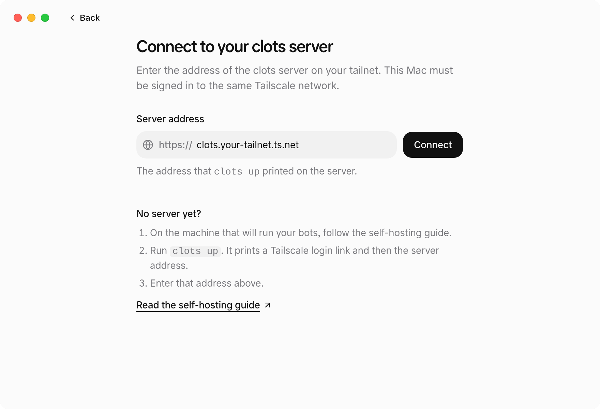

# Remote access with Tailscale

The clots server listens on loopback only. To reach it from your phone or your laptop, clots puts a small sidecar on your [Tailscale](https://tailscale.com) network. There is no hosted relay, no clots account and no port to open on your router.

## How it works

The sidecar (`apps/sidecar`) is a Go program that uses [tsnet](https://tailscale.com/kb/1244/tsnet). It:

1. Joins your tailnet as its own node, named `clots`.
2. Serves HTTPS on `https://clots.<your-tailnet>.ts.net` with a Tailscale certificate.
3. Asks Tailscale who each caller is (`WhoIs`), and admits or rejects the caller.
4. Forwards admitted requests to the clots server on `127.0.0.1:4587`.

The server starts the sidecar itself when the sidecar binary is built. You do not run it by hand.

## Set up

Run `clots up` (see [Installing & building](./install.md)). It prints a login link and a QR code. Open the link and approve the node `clots`.

Your tailnet must have HTTPS certificates enabled. If it does not, `clots up` tells you. Enable them in the Tailscale admin console under **DNS → HTTPS Certificates**: <https://login.tailscale.com/admin/dns>.

When the node is ready, `clots up` prints the address. Open it on any device that is on your tailnet.

In the [Clots app](./desktop.md), choose **On another machine** and enter the address:

<picture>
  <source media="(prefers-color-scheme: dark)" srcset="./assets/setup-remote-dark.png" />
  
</picture>

## Turn it on in the app

The server that the Clots app sets up with **On this machine** stays off the tailnet. To reach it from another device, use the app on that machine:

1. Open the account menu at the bottom of the sidebar and choose **Preferences**.
2. Turn on **Expose over Tailscale**.
3. Choose **Sign in**, sign in to Tailscale in your browser, and approve the node `clots`. You sign in only the first time.

The dialog then shows the address of the server. The QR code button next to it shows the address as a QR code for your phone. The server keeps the choice in `~/.clots/remote-access`, so it also applies after a restart or an update.

The address works while the app runs. When you quit the app, the server stops.

You can turn remote access off only on the machine that runs clots. A device that connects over the tailnet would cut its own connection.

## Who can connect

The default admission mode is `tailscale_owner`: only the Tailscale user who logged the `clots` node in can connect. Tagged devices and other users of the tailnet get a 403 response.

The sidecar also has the mode `tailscale_identified`, which admits each user of the tailnet. The sidecar flag is `--admission`. The server does not expose a setting for it yet.

The sidecar sets the header `Clots-User-Login` to the caller's Tailscale login and removes any value that the caller sent.

## State

The sidecar keeps its Tailscale state in `~/.clots/tailscale`. It writes `status.json` there, which `clots up` and `clots status` read:

| `state` | Meaning |
| --- | --- |
| `needs_login` | Open the `authUrl` to log the node in |
| `needs_https` | Enable HTTPS certificates for the tailnet |
| `ready` | The server is reachable at `url` |

To remove the node, delete it in the Tailscale admin console and delete `~/.clots/tailscale`.
